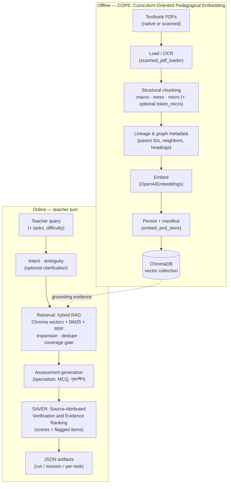

# TeachMateGPT-A-Multi-Agent-Knowledge-Grounded-Framework-for-Pedagogical-Assessment-Generation

Bangla Class 8 science teacher-assistant pipeline for generating textbook-grounded assessments.

This repository implements an end-to-end research workflow:
- ingest NCTB-style textbook PDFs (including scanned PDFs),
- chunk them with curriculum-aware multi-resolution logic (COPE),
- retrieve evidence via hybrid RAG,
- generate selected assessment types (currently MCQ + সৃজনশীল),
- verify faithfulness/relevance risk,
- export full and per-task JSON artifacts for experiments.

---

## 1) What this system does

Given a teacher query (for example, requesting MCQs and creative questions from a chapter), the system:
- classifies intent and handles ambiguity,
- retrieves relevant textbook chunks from ChromaDB using hybrid retrieval,
- generates requested assessment tasks with specialist prompts,
- verifies grounding quality with a verification agent,
- saves machine-readable outputs for downstream evaluation and auditing.

Primary users:
- teachers building classroom question sets,
- researchers running controlled RAG/assessment experiments,
- contributors working on Bangla curriculum-grounded generation.

---

## 2) End-to-end architecture

Runtime graph (`agents/orchestrator.py`) is built with LangGraph:

`intent -> ambiguity -> (clarification or retrieval) -> assessment -> verification -> end`

### Visual overview: COPE → Retrieval → Assessment → SAVER

**Full names (this repo):**

| Short | Full / meaning |
|--------|----------------|
| **COPE** | **C**urriculum-**O**riented **P**edagogical **E**mbedding — ingestion, multi-resolution chunking, embeddings, and Chroma persistence (§3). |
| **Retrieval** | Hybrid **R**etrieval-**A**ugmented **G**eneration-style pipeline: dense vector search + lexical **BM25** + **RRF** (Reciprocal Rank Fusion), neighbor/graph expansion, and coverage gates (§4). Not a separate acronym beyond standard RAG/BM25/RRF. |
| **Assessment generation** | Task-grounded question synthesis (MCQ and সৃজনশীল) via `assessment_agent` and specialist prompts — **not** a spelled acronym in code; “assessment generation” is the descriptive term (§5). |
| **SAVER** | **S**ource-**A**ttributed **V**erification and **E**vidence **R**anking — post-generation faithfulness, relevance, and hallucination-risk scoring (§6). |

The Mermaid diagram below is generated as Markdown in this file (rendered on GitHub/GitLab and many editors). It separates **offline KB construction (COPE)** from the **online teacher path**: retrieval draws evidence from the COPE-built store; **SAVER** runs before JSON export.



High-level module responsibilities:
- `agents/intent_agent.py`: intent classification (science query vs greeting/off-topic/harmful).
- `agents/ambiguity_agent.py`: detects vague/underspecified queries.
- `agents/clarification_agent.py`: generates clarification text/options if needed.
- `agents/retrieval_agent.py`: hybrid retrieval + chunk metadata assembly.
- `agents/concept_detector.py`: chapter/concept labeling from retrieved context.
- `agents/assessment_agent.py`: chooses generation mode and requested tasks.
- `agents/exam_agents/composer.py`: specialist task orchestration.
- `agents/exam_agents/specialists.py`: MCQ and creative question generation + validation.
- `agents/verification_agent.py`: SAVER verification (faithfulness/relevance/hallucination risk).

Skill indirection:
- `agents/skills/registry.py` maps skill IDs (e.g., `retrieval.context`) to callables.
- `agents/skills/__init__.py` exposes safe `run_skill()` execution with error capture.

State model:
- `agents/state.py` defines the graph state payload (`query`, `context`, `assessment`, scores, traces, errors, etc.).

---

## 3) Ingestion and knowledge-base construction (COPE)

Core files:
- `ingestion/educational_chunking.py`
- `ingestion/scanned_pdf_loader.py`
- `ingestion/embed_and_store.py`

### COPE strategy

COPE = Curriculum-Oriented Pedagogical Embedding. It builds retrieval units aligned to textbook pedagogy:
- structural segmentation using Bangla/NCTB heading patterns,
- recursive Bangla-aware splitting,
- multi-tier chunking (`macro`, `meso`, `micro`, optional `token_micro`),
- lineage metadata for parent/neighbor/graph expansion at retrieval time.

Each chunk includes rich metadata such as:
- `chunk_uid`, `chunk_tier`, `pedagogical_layer`,
- `structural_heading`, `structural_unit_idx`, `grain_idx`, `sequence`,
- parent/lineage IDs (`parent_macro_id`, `parent_meso_id`, etc.),
- graph links (`prev_chunk_uid`, `next_chunk_uid`, `graph_neighbors`).

### Scanned PDF support

`ingestion/scanned_pdf_loader.py` supports:
- `native`: direct text extraction,
- `vision` (alias `ocr`): page rasterization + vision transcription,
- `auto`: native when enough text exists, vision fallback otherwise.

Vision transcription uses `utils/llm_client.py` with model/config knobs from `config.py`.

### Vector store build

`ingestion/embed_and_store.py`:
- loads all textbooks from `config.TEXTBOOK_DIR`,
- runs chunking,
- optionally recreates collection (`RECREATE_COLLECTION_ON_INGEST`),
- embeds via `OpenAIEmbeddings`,
- stores into Chroma (`config.CHROMA_DB_PATH`, `config.CHROMA_COLLECTION_NAME`),
- writes ingest manifest under `data/experiment/`.

---

## 4) Retrieval design

Implemented in `agents/retrieval_agent.py`.

Pipeline highlights:
- query normalization + follow-up extraction,
- retrieval query planning (`_analyze_query_for_retrieval`),
- hybrid search:
  - vector retrieval from Chroma,
  - lexical BM25 over corpus documents,
  - weighted RRF merge,
- dynamic anchor term extraction (IDF-like weighting over corpus),
- topic/section focus heuristics + polarity conflict guards,
- noisy chunk filtering,
- section-neighbor and graph-based expansion for broad chapter queries,
- CCI-style parent macro injection,
- CCR-style dedupe/conflict simplification,
- final query-coverage gate (`RETRIEVAL_MIN_QUERY_COVERAGE`) to fail closed when evidence is weak.

Output shape from retrieval skill:
- `context`: list of chunk texts,
- `sources`: deduplicated source filenames,
- `retrieval_chunks`: full metadata records for audit/eval/export.

---

## 5) Assessment generation

Entry: `agents/assessment_agent.py`.

Modes:
- `monolithic`: one prompt (`prompts/assessment_prompt.md`).
- `specialized_agents`: task-specific specialists via `agents/exam_agents/`.

Current canonical task keys (`config.ALL_ASSESSMENT_TASK_KEYS`):
- `mcqs`
- `creative_questions`

Specialist flow:
- `agents/exam_agents/composer.py` runs requested tasks in canonical order.
- `agents/exam_agents/specialists.py` handles:
  - prompt execution (`prompts/exam_mcq.md`, `prompts/exam_srijonshil.md`),
  - retries up to configured attempts,
  - de-duplication,
  - validation gates (format/language/grounding/narrative checks),
  - count capping using `config.ASSESSMENT_COUNTS`.

---

## 6) Verification (SAVER)

`agents/verification_agent.py` performs post-generation quality checks:
- faithfulness to retrieved context,
- relevance to teacher query/task request,
- hallucination risk scoring.

It outputs:
- `is_faithful`,
- `faithfulness_score`,
- `answer_relevance_score`,
- `hallucination_risk_score` and level,
- `flagged_items` with issues and evidence notes.

Orchestrator then enforces thresholds from `config.py`:
- `MIN_FAITHFULNESS_SCORE`
- `MIN_ANSWER_RELEVANCE_SCORE`
- `MAX_HALLUCINATION_RISK_SCORE`

---

## 7) Output artifacts

Export logic: `utils/teacher_turn_export.py`.

For each run:
- full run JSON: `output/run_<run_id>.json`
- session append log: `output/teacher_sessions/<session_id>.jsonl`
- per-task artifact (only if that task has non-empty items):
  - `output/tasks/<task_key>/run_<run_id>.json`
  - `output/tasks/<task_key>/<session_id>.jsonl`

Artifacts contain:
- query and selected tasks,
- difficulty,
- retrieved chunks and sources,
- chapter/concept labels,
- generated task items,
- verification report and scores,
- execution trace and errors,
- task output paths.

---

## 8) Interfaces (how to run)

### A) Streamlit UI

File: `app.py`

Features:
- chat-style teacher interaction,
- difficulty selector,
- task multiselect (`mcqs`, `creative_questions`),
- session ID management,
- downloadable run JSON and session JSONL,
- expandable per-task JSON display.

Run:

```bash
streamlit run app.py
```

### B) CLI single run

File: `run.py`

Run:

```bash
python run.py --level intermediate --session my_session "আপনার কুয়েরি এখানে"
```

Optional:
- `--tasks mcqs,creative_questions`
- `--no-save` to print JSON to stdout only

### C) Batch mode

File: `run_batch.py`

Behavior:
- reads JSON files from `batch_input/`,
- runs orchestrator query-by-query,
- writes technical full-run exports through normal exporter,
- writes convenience task files under `batch_output/` (`mcq/`, `srijonshil/`).

---

## 9) Configuration guide

Main config file: `config.py`

Important groups:
- OpenAI models and temperature.
- Chroma paths/collection.
- COPE chunking sizes/overlaps and separators.
- scanned PDF mode + preprocessing knobs.
- generation mode and task counts.
- retrieval breadth/focus/coverage thresholds.
- pre-generation coverage gate and neighbor retry behavior.
- verification thresholds.
- output directories.

If behavior looks wrong, check these first:
- `ASSESSMENT_GENERATION_MODE`
- `ASSESSMENT_COUNTS`
- `ALL_ASSESSMENT_TASK_KEYS`
- `RETRIEVAL_*`
- `PREGEN_*`
- `RUN_OUTPUT_DIR` / `TEACHER_TASK_SUBROOT`

---

## 10) Prompts and utilities

Prompt files (under `prompts/`):
- `intent_prompt.md`
- `clarification_prompt.md`
- `assessment_prompt.md`
- `exam_mcq.md`
- `exam_srijonshil.md`
- plus other prompt assets depending on branch/work state.

Utility modules:
- `utils/llm_client.py`: chat/vision calls.
- `utils/prompt_loader.py`: prompt file loading.
- `utils/logger.py`: logging helper functions.
- `utils/bangla_utils.py`: Bangla normalization helpers.
- `utils/teacher_turn_export.py`: run/session/task serialization.

---

## 11) Minimal setup

1. Create `.env` with:
   - `OPENAI_API_KEY=...`
2. Install dependencies:

```bash
pip install -r requirements.txt
```

3. Put textbook files in `data/textbooks/`.
4. Build vector store:

```bash
python ingestion/embed_and_store.py
```

5. Run UI or CLI.

---

## 12) Reproducibility and research workflow

Recommended experiment cycle:
- fix config snapshot for an experiment,
- ingest once and save manifest,
- run multiple sessions with stable session IDs,
- compare outputs by `run_id`,
- audit retrieval chunks + verification flags,
- iterate prompts/retrieval/gating,
- re-run with same seeds/settings where possible.

Useful record files:
- `output/run_<run_id>.json` (single-run ground truth artifact),
- `output/teacher_sessions/<session>.jsonl` (session timeline),
- per-task run files under `output/tasks/`.

---

## 13) Known pitfalls / troubleshooting

- Missing task output file usually means that task list was selected but generated items were empty after validation (check full run JSON `assessment.<task>` and `verification_report`).
- `ModuleNotFoundError: langchain_chroma` means environment mismatch or incomplete dependency install in the active Python environment.
- Empty retrieval context usually indicates strict topic/coverage gating; inspect `errors`, retrieval config thresholds, and query wording.
- Scanned PDF quality depends on `PDF_RENDER_SCALE`, preprocessing, and vision model details.

---

## 14) Repository map

Top-level runtime files:
- `app.py` (Streamlit)
- `run.py` (single-run CLI)
- `run_batch.py` (batch CLI)
- `config.py` (all knobs)

Main packages:
- `agents/`
- `ingestion/`
- `prompts/`
- `utils/`
- `scripts/` (support utilities)
- `output/` and `logs/` (runtime artifacts)

---

## 15) Scope note

Current active output task types in this branch are:
- MCQ (`mcqs`)
- Creative/Srijonshil (`creative_questions`)

If additional task types existed in older branches or documents, verify against current `config.ALL_ASSESSMENT_TASK_KEYS` and the specialist registry before assuming they are active.
