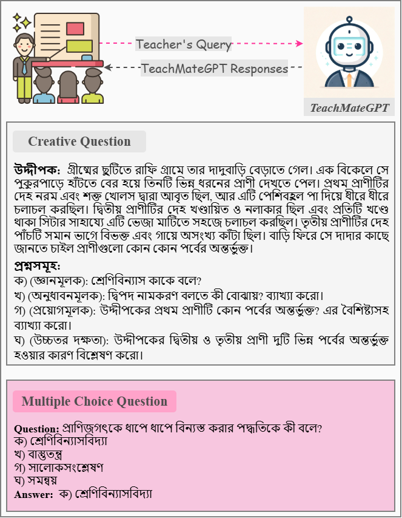
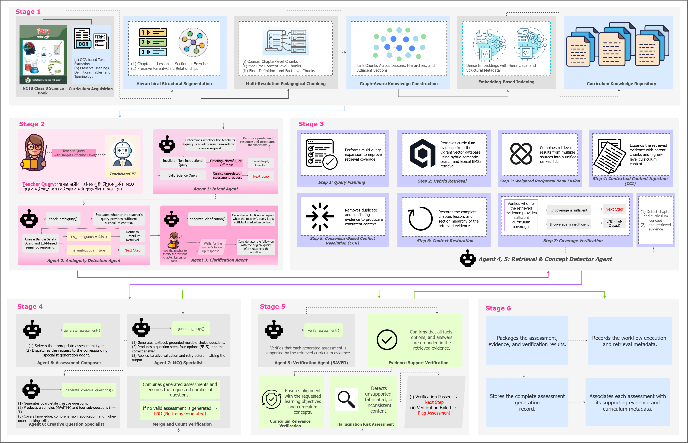
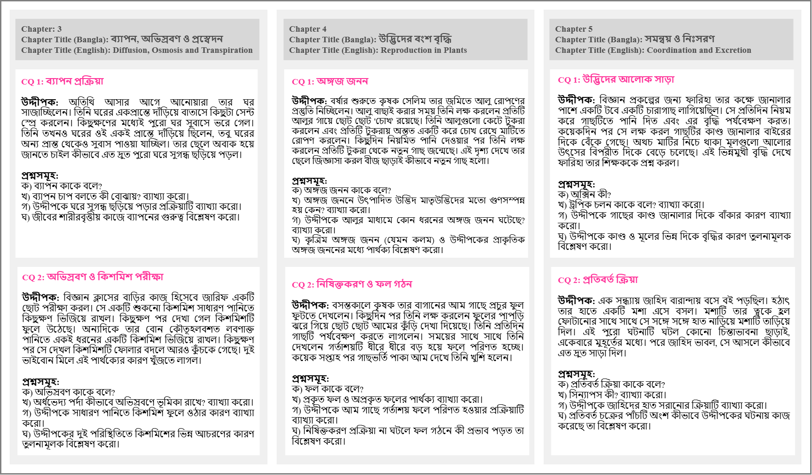
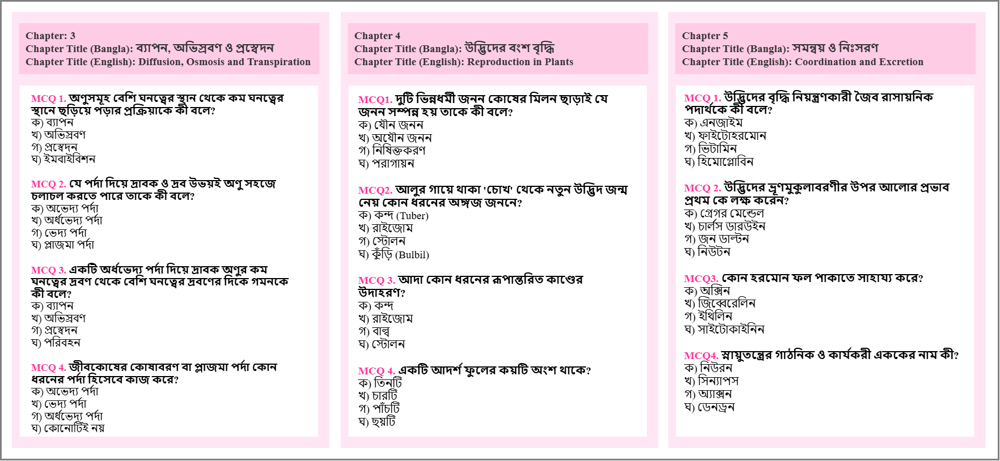

# TeachMateGPT: A Multi-Agent Knowledge-Grounded Framework for Pedagogical Assessment Generation from Science Curriculum Materials

Writing a full set of board-style assessments by hand, chapter after chapter, is one of the
heaviest recurring demands on a science teacher's time. Large language models can speed this up,
but generation left unconstrained tends to invent facts, drift away from the intended chapter,
produce weak distractors, or break the expected board format, risks a teacher cannot afford to
hand to students untested. The stakes are higher still for Bangladeshi science teachers, who must
prepare Class 8 assessments strictly from the National Curriculum and Textbook Board (NCTB)
syllabus: every item has to align with the textbook, read naturally in Bangla, and match a
requested difficulty level.

Retrieval-augmented generation (RAG) is the standard answer to hallucination, and it has become
common in educational NLP. Yet the RAG systems built for this space so far retrieve over flat,
fixed-size chunks that ignore how a textbook is actually organized, generate one question format
at a time rather than the mixed MCQ-and-creative-question sets a real exam needs, and rarely stop
to ask whether the evidence they found is even sufficient before generating an answer. For Bangla
NCTB material specifically, the systems that exist mostly answer student questions; almost none
author teacher-facing, multi-format assessments, and fewer still know when to refuse rather than
guess. A plain retrieve-then-generate pipeline cannot close these gaps either: teacher requests
are often underspecified and need clarification, the textbooks themselves are noisy (many are
scanned, not born-digital), MCQs and creative questions impose very different structural rules,
and every generated item still needs a check before it reaches a classroom. **TeachMateGPT**
addresses this with a multi-agent system built around four advances in curriculum-grounded
science-assessment authoring:

| Mechanism | What it does | Why it matters |
|---|---|---|
| **COPE** (Curriculum-Oriented Pedagogical Embedding) | Replaces fixed-size token-window chunking with a hierarchical index that segments textbooks along syllabus structure (chapter → section → chunk) at three resolutions (macro/meso/micro), and links them with lineage and neighbor edges set at ingest time | Lets retrieval match evidence granularity to a teacher's request and traverse outward to recover related instructional content, not just a single parent chunk |
| **IAC** (Intent, Ambiguity detection, and Clarification) | A staged, fail-closed routing layer that screens greetings, harmful requests, and off-topic input, flags underspecified topics, and asks for clarification before retrieval begins | Only well-specified curriculum requests reach retrieval and generation |
| **Hybrid retrieval with CCI/CCR and a coverage gate** | Fuses dense and lexical (BM25) retrieval via weighted reciprocal rank fusion, restores pedagogical context around isolated fragments (**CCI**), removes redundant overlapping evidence (**CCR**), and withholds generation when curriculum coverage falls short | Stops assessment authoring on weak evidence instead of generating on a guess |
| **SAVER** (Source-Attributed Verification and Evidence Ranking) | A post-generation agent that scores faithfulness, curriculum relevance, and hallucination risk for every item against its retrieved evidence, and applies stricter checks across each creative question's four sub-parts | Flags unsupported items for **teacher review** instead of silently filtering or auto-releasing them |

To evaluate it we release **NCTB-SciGen8**, a curriculum-grounded dataset of 198 Bangla Class 8
science assessment items (143 MCQs and 55 creative questions) that spans all 14 chapters of the
official NCTB Class 8 Science textbook. The pipeline produced every item directly, and three
practicing teachers rated them. TeachMateGPT raises faithfulness from **0.68 to 0.96** and answer
relevancy from **0.60 to 0.89** over a vanilla RAG baseline, beats RAPTOR, GraphRAG, CRAG, and
Adaptive RAG baselines, and raises teacher-rated overall utility from **2.00 to 4.80** on a
5-point scale.

- 📄 Paper: https://arxiv.org/abs/2608.13708
- 🤗 Dataset (NCTB-SciGen8): *to be released under CC BY-NC 4.0 for non-commercial research use*



---

## Dataset: NCTB-SciGen8

NCTB-SciGen8 holds 198 Bangla question items that the pipeline generated and verified directly,
and it covers the full NCTB Class 8 Science syllabus (14 chapters, 156 pages) across Biology,
Chemistry, Physics, and Environment. Each item keeps its full generation record: the teacher
query, the retrieved evidence with source, chapter, and concept labels, the generated item
itself, and its SAVER verification report. Three practicing science teachers independently
reviewed a subset of the items.

**Per-chapter breakdown**

| Ch. | Chapter (English) | Pages | MCQ | CQ | Subject |
|--:|---|---|--:|--:|---|
| 1 | Classification of Animal Kingdom | 1–12 | 13 | 4 | Biology |
| 2 | Growth & Heredity of Organisms | 13–23 | 11 | 4 | Biology |
| 3 | Diffusion, Osmosis & Transpiration | 24–33 | 10 | 4 | Biology |
| 4 | Reproduction in Plants | 34–44 | 10 | 4 | Biology |
| 5 | Coordination & Excretion | 45–54 | 9 | 4 | Biology |
| 6 | Structure of the Atom | 55–64 | 11 | 4 | Chemistry |
| 7 | Earth & Gravitation | 65–74 | 10 | 4 | Physics |
| 8 | Chemical Reactions | 75–88 | 12 | 5 | Chemistry |
| 9 | Circuit & Current Electricity | 89–97 | 10 | 4 | Physics |
| 10 | Acid, Base & Salt | 98–107 | 10 | 4 | Chemistry |
| 11 | Light | 108–118 | 8 | 4 | Physics |
| 12 | Space & Satellites | 119–128 | 9 | 3 | Physics |
| 13 | Food & Nutrition | 129–146 | 10 | 4 | Biology |
| 14 | Environment & Ecosystem | 147–156 | 10 | 3 | Environment |
| **Total** | **14 chapters, 156 pages** | | **143** | **55** | |

Every MCQ follows the NCTB format: a Bangla stem with four options, **ক/খ/গ/ঘ**. Every CQ follows
the board-style structure: an **উদ্দীপক** (stimulus) with four cognitive-level sub-questions,
**Gyan** (knowledge), **Onudhabon** (comprehension), **Proyog** (application), and **Ucchotor
Dokkhota** (higher-order skills).

---

## Methodology

The dataset above comes directly from the pipeline described here. A teacher query passes
through six stages:



| Stage | Agent(s) | Role |
|---|---|---|
| 1. Knowledge Base Construction (**COPE**) | *(offline)* | Curriculum acquisition (native and vision-OCR text extraction), hierarchical structural segmentation along syllabus boundaries, multi-resolution chunking (macro/meso/micro), graph-aware lineage and neighbor links, embedding-based indexing |
| 2. Intent Analysis & Query Routing (**IAC**) | Intent Agent, Ambiguity Detection Agent, Clarification Agent | Filters unrelated or harmful queries, flags underspecified topics, and requests clarification before retrieval continues |
| 3. Hybrid Retrieval, Evidence Refinement & Coverage Validation | Retrieval Agent, Concept Detector | Dense and lexical (BM25) hybrid search merged by weighted RRF; **CCI** restores context; **CCR** reduces redundancy; a coverage gate withholds generation on insufficient evidence; evidence is labeled with chapter and concept |
| 4. Multi-Format Assessment Generation | Assessment Composer, MCQ Specialist, Creative Specialist | Produces NCTB-format MCQs and board-style CQs at the requested difficulty, grounded in the same validated evidence |
| 5. Source-Attributed Verification (**SAVER**) | Verification Agent | Scores faithfulness, curriculum relevance, and hallucination risk per item, and flags unsupported items for teacher attention instead of auto-filtering them |
| 6. Auditable Output Packaging | *(export)* | Packages the query, evidence with provenance, generated item, verification report, and execution trace into one record, the basis of NCTB-SciGen8 |

**COPE indexing, in numbers.** All 14 chapters are ingested into 793 total chunks: 181 macro-tier
(3600/650 character window/overlap), 255 meso-tier (1900/320), and 357 micro-tier (1100/180).

---

## Results

The six stages above are evaluated below, first with automatic metrics, then with human
judgment.

**RAGAS evaluation: TeachMateGPT against ablations and RAG baselines**

| Configuration | Faithfulness ↑ | Answer Relevancy ↑ | Context Precision ↑ | Context Recall ↑ |
|---|--:|--:|--:|--:|
| **TeachMateGPT** | **0.96** | **0.89** | **0.92** | **0.91** |
| w/o COPE | 0.86 | 0.76 | 0.73 | 0.75 |
| w/o SAVER | 0.79 | 0.86 | 0.90 | 0.89 |
| w/o CCR | 0.83 | 0.81 | 0.84 | 0.85 |
| w/o CCI | 0.84 | 0.82 | 0.85 | 0.86 |
| w/o IAC | 0.81 | 0.77 | 0.89 | 0.88 |
| Vanilla RAG | 0.68 | 0.60 | 0.54 | 0.58 |
| RAPTOR | 0.80 | 0.75 | 0.71 | 0.78 |
| GraphRAG | 0.84 | 0.79 | 0.80 | 0.83 |
| CRAG | 0.86 | 0.81 | 0.84 | 0.85 |
| Adaptive RAG | 0.79 | 0.76 | 0.73 | 0.79 |

**Human evaluation** (three practicing science teachers, 5-point Likert scale, mean ± s.d.)

| Configuration | Pedagogical Alignment ↑ | Stimulus Realism ↑ | Linguistic Fluency ↑ | Overall Utility ↑ |
|---|--:|--:|--:|--:|
| **TeachMateGPT** | **4.90 ± 0.10** | **4.70 ± 0.10** | **4.60 ± 0.10** | **4.80 ± 0.10** |
| w/o COPE | 4.05 ± 0.10 | 3.90 ± 0.12 | 4.35 ± 0.08 | 3.95 ± 0.10 |
| w/o SAVER | 3.25 ± 0.12 | 4.25 ± 0.10 | 4.25 ± 0.10 | 3.55 ± 0.12 |
| w/o CCR | 3.80 ± 0.10 | 4.05 ± 0.10 | 4.30 ± 0.08 | 3.95 ± 0.10 |
| w/o CCI | 3.75 ± 0.10 | 4.00 ± 0.10 | 4.25 ± 0.10 | 3.85 ± 0.10 |
| w/o IAC | 3.50 ± 0.12 | 3.85 ± 0.12 | 4.15 ± 0.10 | 3.60 ± 0.12 |
| Vanilla RAG | 2.40 ± 0.12 | 1.75 ± 0.10 | 3.00 ± 0.12 | 2.00 ± 0.10 |
| RAPTOR | 3.55 ± 0.12 | 3.60 ± 0.12 | 4.00 ± 0.10 | 3.55 ± 0.12 |
| GraphRAG | 3.70 ± 0.10 | 3.85 ± 0.10 | 4.10 ± 0.10 | 3.75 ± 0.10 |
| CRAG | 3.85 ± 0.10 | 3.95 ± 0.10 | 4.20 ± 0.08 | 3.95 ± 0.10 |
| Adaptive RAG | 3.60 ± 0.10 | 3.75 ± 0.10 | 4.05 ± 0.10 | 3.70 ± 0.10 |

**Retrieval reliability and efficiency.** The default hybrid (dense + BM25) retrieval with the
coverage gate holds a 12.5% fail-closed rate at a 0.724 mean coverage ratio over 16
non-ambiguous evaluation queries. Dense-only retrieval raises refusal to 31.3% and lowers
coverage to 0.618. TeachMateGPT needs only 2.1 mean LLM calls per query and 11.3s mean latency,
with **zero** one-time indexing cost, against RAPTOR (66 index-build LLM calls, 224.3s build
time) and GraphRAG (82 calls, 287.5s build time).

**Takeaways.** Faithfulness drops most when **SAVER** is removed (0.96 to 0.79), and so does
pedagogical alignment (4.90 to 3.25). Answer relevancy and stimulus realism drop most when
**COPE** is removed (relevancy: 0.89 to 0.76). Retrieval and verification therefore play
complementary, non-redundant roles. MCQ generation reaches 85.7% first-attempt validation
success, and CQ generation climbs from 7.1% to 100% after a narrative-style adjustment; most
early CQ failures traced back to stimulus framing rather than weak curriculum grounding.

**Qualitative examples: creative questions (উদ্দীপক with ক–ঘ sub-questions)**



**Qualitative examples: MCQs (stem with four options)**



---

## Getting started

The rest of this document shows how to run the pipeline yourself.

### 1. Install

It requires Python 3.10 or newer and an OpenAI API key for chat generation; embeddings run
locally and need no external key.

```bash
git clone https://github.com/fatemafaria142/TeachMateGPT-A-Multi-Agent-Knowledge-Grounded-Framework-for-Pedagogical-Assessment-Generation
cd TeachMateGPT-A-Multi-Agent-Knowledge-Grounded-Framework-for-Pedagogical-Assessment-Generation
pip install -r requirements.txt
```

### 2. Configure

Create a `.env` file in the project root:

```ini
OPENAI_API_KEY=sk-...                    # required, used for chat generation
EMBEDDING_DEVICE=cuda                    # or "cpu"; runs the local BAAI/bge-m3 embedding model
RECREATE_COLLECTION_ON_INGEST=false      # true rebuilds the Qdrant collection from scratch
```

### 3. Ingest the curriculum

Drop one or more NCTB-style textbook PDFs (native or scanned) into `data/textbooks/`, then
build the knowledge base. COPE extracts text (native or vision OCR), segments it along
syllabus structure, chunks it at three resolutions, links chunks via ingest-time lineage, and
embeds everything into a local Qdrant store (`knowledge_base/qdrant_store`). Run this once per
corpus.

```bash
mkdir -p data/textbooks && cp /path/to/textbook.pdf data/textbooks/
python ingestion/embed_and_store.py
```

### 4. Ask a question

```bash
python run.py --level intermediate --session my_session "ব্যাপন ও অভিস্রবণ নিয়ে এমসিকিউ তৈরি করো"
```

Optional flags:
- `--level beginner|intermediate|advanced`: requested difficulty
- `--tasks mcqs,creative_questions`: restrict to selected task types (default: both)
- `--no-save`: print the JSON record to stdout only

The pipeline classifies intent, routes or clarifies ambiguous queries, retrieves and validates
curriculum evidence, generates the requested item types, verifies each item with SAVER, and
writes an auditable JSON record to `output/run_<run_id>.json` (it also appends to
`output/teacher_sessions/<session>.jsonl`).

### 5. (Optional) Streamlit UI

```bash
streamlit run app.py
```

### 6. (Optional) Batch mode

Drop one or more query JSON files into `batch_input/`, then run every query through the
pipeline in one pass:

```bash
python run_batch.py
```

### 7. (Optional) Run the evaluation suite

```bash
python scripts/run_eval.py --list                           # list every registered configuration
python scripts/run_eval.py --all --offline --limit 4         # smoke-test the plumbing, no API key needed
python scripts/run_eval.py --all --live                      # the real thing (needs OPENAI_API_KEY)
python scripts/run_eval.py --report                          # render collected live results into tables
```

Retrieval-strategy baselines (RAPTOR, GraphRAG, CRAG, Adaptive RAG) and the COPE/SAVER/CCR/CCI
component ablations used in the Results tables above all run through this harness as named
configs; see `eval/configs.py`.

## Citation

```bibtex
@misc{faria2026teachmategptmultiagentknowledgegroundedframework,
      title={TeachMateGPT: A Multi-Agent Knowledge-Grounded Framework for Pedagogical Assessment Generation from Science Curriculum Materials}, 
      author={Fatema Tuj Johora Faria and Mukaffi Bin Moin and M. F. Mridha and Jubayer Al Mahmud},
      year={2026},
      eprint={2608.13708},
      archivePrefix={arXiv},
      primaryClass={cs.CL},
      url={https://arxiv.org/abs/2608.13708}, 
}
```
