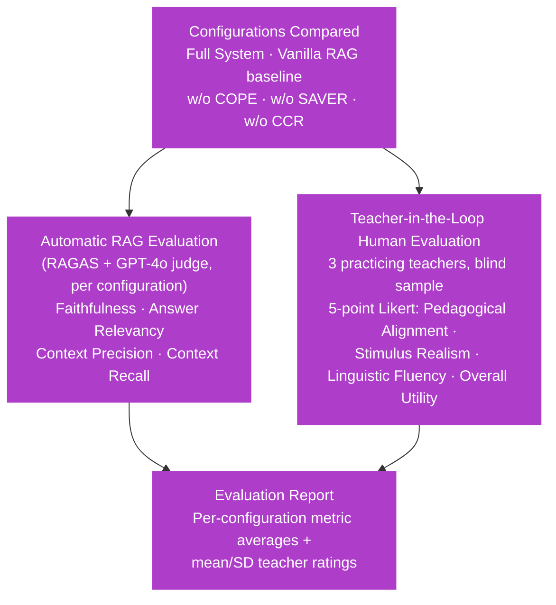
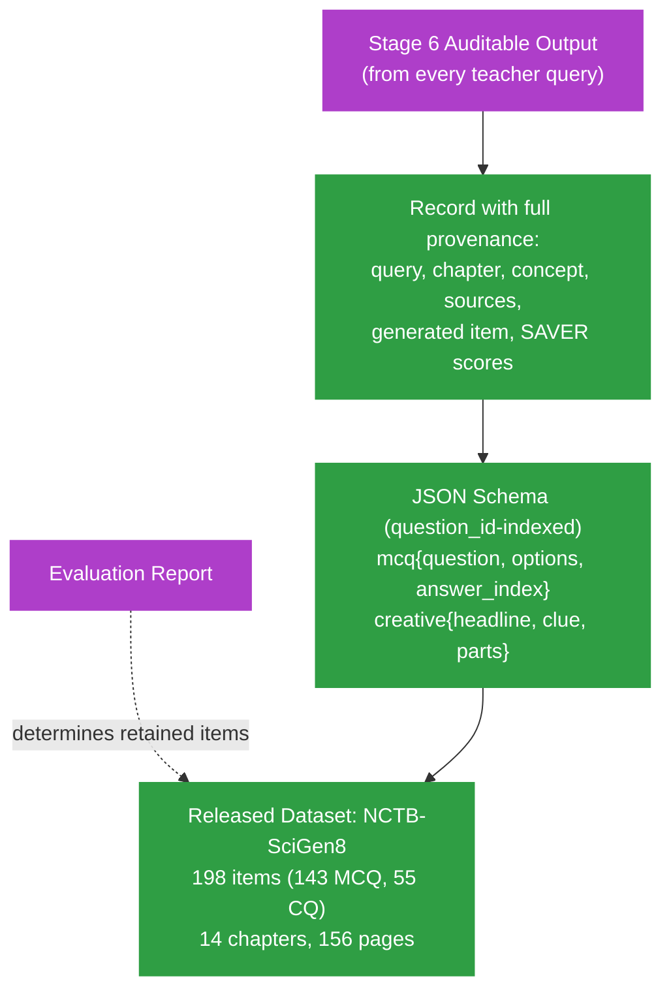

# TeachMateGPT — Detailed Methodology Diagram

Source: derived from `paper/METHODOLOGY.md` (COPE, retrieval/orchestration, SAVER),
`docs/agents.md` (9-agent pipeline), and the Figure 2 caption (six-stage
end-to-end architecture). Render with any Mermaid-compatible viewer (GitHub,
VS Code Mermaid extension, mermaid.live, or the Claude Artifact renderer).

```mermaid
flowchart TD

    %% ===================== STAGE 1 =====================
    subgraph STAGE1["Stage 1 — Curriculum Knowledge Repository Construction (COPE)"]
        direction TB
        D["Authorized NCTB Class 8\nScience Curriculum Documents 𝒟"]
        P1["(1) Curriculum Acquisition\nOCR/text extraction, preserve headings,\ndefinitions, tables, terminology; normalize"]
        P2["(2) Hierarchical Structural Segmentation\nChapter → Lesson → Section → Exercise\n(preserve parent-child relationships)"]
        P3["(3) Multi-Resolution Pedagogical Chunking\nCoarse (chapter-level) / Medium (concept) /\nFine (definition/fact) chunks"]
        P4["(4) Graph-Aware Knowledge Construction\nLink chunks across lesson/hierarchy/\nadjacent sections (lightweight graph)"]
        P5["(5) Embedding-Based Indexing\nDense embeddings + hierarchical &\nstructural metadata"]
        K["Curriculum Knowledge Repository 𝒦\n𝒦 = {(c, e_c, meta(c))}"]

        D --> P1 --> P2 --> P3 --> P4 --> P5 --> K
    end

    %% ===================== STAGE 2 =====================
    subgraph STAGE2["Stage 2 — Intent Identification, Ambiguity Resolution & Routing"]
        direction TB
        Q["Teacher Query q\n(difficulty ℓ, type S ∈ {MCQ, CQ})"]

        A1["Agent 1 — Intent Agent\nclassify_intent()\nIdentifies teacher's intent:\ngreeting / harmful / off_topic / science_query"]
        SINK1["Fixed-reply sink\n(greeting / harmful / off_topic) → END"]

        A2["Agent 2 — Ambiguity Agent\ncheck_ambiguity()\nResolves ambiguous queries:\nBangla specificity guard + LLM judgment"]
        A3["Agent 3 — Clarification Agent\ngenerate_clarification()\nAsks teacher for a more specific\nchapter/topic before proceeding"]
        SINK2["END — awaits teacher follow-up\n(query concatenated on next turn)"]

        Q --> A1
        A1 -->|greeting / harmful / off_topic| SINK1
        A1 -->|science_query — valid request routed onward| A2
        A2 -->|is_ambiguous = true| A3 --> SINK2
        A2 -->|is_ambiguous = false — routed to retrieval| STAGE3ENTRY["to Stage 3"]
    end

    %% ===================== STAGE 3 =====================
    subgraph STAGE3["Stage 3 — Hybrid Evidence Retrieval, Expansion & Coverage Verification"]
        direction TB
        A4["Agent 4 — Retrieval Agent\nretrieve_context()"]

        subgraph RETR["Inside Agent 4"]
            direction TB
            R1["Query planning / multi-query expansion"]
            R2["Combines Dense (Chroma) ⊕\nLexical BM25 retrieval"]
            R3["Weighted Reciprocal Rank Fusion\nScore(c) = Σ_r w_r / (k + rank_r(c))"]
            R4["Expands Curriculum Evidence — CCI\n(Contextual Content Injection:\nparent-chunk / higher-level context)"]
            R5["CCR — Consensus-Based Conflict Resolution\n(resolve_conflicts: dedupe near-duplicate evidence)"]
            R6["Restores Lesson Context\n(reattach chapter/lesson/section lineage)"]
            R7["Applies Coverage Check\nCov(T,E) = |{t ∈ T : t ∈ E}| / |T|"]
            R1 --> R2 --> R3 --> R4 --> R5 --> R6 --> R7
        end

        SINK3["END — fail-closed\n(empty context or coverage below threshold)"]

        A5["Agent 5 — Concept Detector\ndetect_concept()\nLabels chapter + concept (Bangla)\non the restored, coverage-verified evidence"]

        STAGE3ENTRY2["from Stage 2"] --> A4
        A4 --> RETR
        RETR -->|coverage gate fails| SINK3
        RETR -->|evidence accepted E| A5
    end

    K -.retrieval source.-> A4
    STAGE3ENTRY -.-> STAGE3ENTRY2

    %% ===================== STAGE 4 =====================
    subgraph STAGE4["Stage 4 — Textbook-Grounded Assessment Generation"]
        direction TB
        A6["Agent 6 — Assessment Composer\ngenerate_assessment()\nDispatches to specialist agents\n(specialized generation mode)"]
        A7["Agent 7 — MCQ Specialist\nspecialist_mcqs()\nTextbook-grounded MCQ:\nstem + 4 options (ক–ঘ) + answer index\nvalidate → retry (strict→relaxed→final) → force-fill"]
        A8["Agent 8 — Creative Specialist (Srijonshil)\nspecialist_srijonshil()\nBoard-style creative question:\nউদ্দীপক stimulus + 4 sub-questions (ক–ঘ)\n(knowledge / comprehension / application / HOTS)"]
        MERGE["Merge & Clip to Requested Counts\nA = G(E, ℓ, S, q)"]
        SINK4["END — no items generated"]

        A5 --> A6
        A6 --> A7
        A6 --> A8
        A7 --> MERGE
        A8 --> MERGE
        MERGE -->|no items| SINK4
    end

    %% ===================== STAGE 5 =====================
    subgraph STAGE5["Stage 5 — Evidence-Support, Faithfulness & Relevance Verification (SAVER)"]
        direction TB
        A9["Agent 9 — Verification Agent (SAVER)\nverify_faithfulness()"]

        subgraph SAVER["SAVER checks"]
            direction TB
            S1["Verifies Evidence Support\nfacts/options entailed by retrieved evidence"]
            S2["Verifies Curriculum Relevance\nalignment with learning objective & concepts"]
            S3["Estimates Hallucination Risk\nunsupported/fabricated content"]
            ACC["Accept(V) = b_faith ∧ (s_faith ≥ θ_F)\n∧ (s_rel ≥ θ_R) ∧ (s_hall ≤ θ_H)\nFlags unsupported outputs if not met"]
            S1 --> ACC
            S2 --> ACC
            S3 --> ACC
        end

        FLAG["Flagged / Warned Output\n(teacher-visible caveat on unsupported items)"]

        MERGE --> A9
        A9 --> SAVER
        SAVER -->|rejected| FLAG
        SAVER -->|accepted| PKG_ENTRY["to Stage 6"]
    end

    %% ===================== STAGE 6 =====================
    subgraph STAGE6["Stage 6 — Auditable Packaging & Traceable Output"]
        direction TB
        PKG["Package Run Record\n(build_teacher_turn_record)\nteacher query + retrieved evidence +\ngenerated assessment + verification report +\nexecution trace"]
        TRACE["Execution Trace\n(per-node ok/fail, fallback flags,\nchunk counts — one entry per stage 1-5 hop)"]
        RUNFILE["run_<run_id>.json\n+ session_id.jsonl\n(append-only, per teacher session)"]
        TASKFILES["Per-task artifacts\n<task>/run_<run_id>.json\n(mcqs/, creative_questions/, ... with\nsources + retrieval_chunks + chapter/concept)"]
        TRACEABLE["Auditable Output to Teacher\nAssessment + Verification Report +\nfull textbook traceability\n(chapter → lesson → source chunk)"]

        PKG_ENTRY2["from Stage 5"] --> PKG
        FLAG -.included as warned items.-> PKG
        PKG --> TRACE
        PKG --> RUNFILE
        PKG --> TASKFILES
        RUNFILE --> TRACEABLE
        TASKFILES --> TRACEABLE
        TRACE --> TRACEABLE
    end

    PKG_ENTRY -.-> PKG_ENTRY2

    classDef phase fill:#0b7285,stroke:#0b7285,color:#fff;
    classDef agent fill:#1971c2,stroke:#1971c2,color:#fff;
    classDef gate fill:#e8590c,stroke:#e8590c,color:#fff;
    classDef sink fill:#868e96,stroke:#868e96,color:#fff;
    classDef store fill:#2f9e44,stroke:#2f9e44,color:#fff;
    classDef pkg fill:#ae3ec9,stroke:#ae3ec9,color:#fff;

    class D,P1,P2,P3,P4,P5 phase
    class K,RUNFILE,TASKFILES store
    class A1,A2,A3,A4,A5,A6,A7,A8,A9 agent
    class R7,ACC gate
    class SINK1,SINK2,SINK3,SINK4,FLAG sink
    class PKG,TRACE,TRACEABLE pkg
```

## Legend

| Style | Meaning |
|---|---|
| Blue | One of the 9 pipeline agents (`docs/agents.md`) |
| Teal | COPE knowledge-base construction step (Stage 1) |
| Orange | Gating / acceptance decision point |
| Gray | Terminal sink node (fixed reply, clarification wait, fail-closed abstention, flagged output) |
| Green | Persistent artifact / stored repository or run file |
| Purple | Stage 6 packaging / auditable-output artifact |

## Stage-by-stage summary (matches the Figure 2 caption)

- **Stage 1 — Knowledge Base Construction.** Constructs the COPE-based curriculum knowledge repository 𝒦 from the NCTB textbook: acquisition → hierarchical segmentation → multi-resolution chunking → graph-aware linking → embedding-based indexing. Runs once, offline, before deployment.
- **Stage 2 — Intent, Ambiguity & Routing.** **Agent 1 (Intent)** identifies the teacher's intent and sinks greeting/harmful/off-topic queries immediately. **Agent 2 (Ambiguity)** resolves ambiguous queries; if ambiguous, **Agent 3 (Clarification)** asks the teacher to be more specific and the turn ends awaiting follow-up. Valid, unambiguous requests are routed to Stage 3.
- **Stage 3 — Hybrid Retrieval, Expansion & Coverage Check.** **Agent 4 (Retrieval)** combines dense (Chroma) and BM25 lexical retrieval, fuses ranks (weighted RRF), expands curriculum evidence via CCI (parent-chunk context injection), deduplicates conflicting evidence via CCR, restores full lesson context (chapter/lesson/section lineage), and applies a coverage gate — fail-closed if evidence is empty or under-covers the query. **Agent 5 (Concept Detector)** then labels the accepted evidence with chapter + concept.
- **Stage 4 — Assessment Generation.** **Agent 6 (Composer)** dispatches to specialist generators on the same validated evidence: **Agent 7 (MCQ Specialist)** produces textbook-grounded MCQs (stem + 4 options ক–ঘ + answer index, with a strict→relaxed→final retry ladder), and **Agent 8 (Creative Specialist)** produces board-style creative questions (উদ্দীপক stimulus + 4 sub-questions ক–ঘ spanning knowledge/comprehension/application/HOTS). Outputs are merged and clipped to requested counts.
- **Stage 5 — Verification (SAVER).** **Agent 9 (Verification)** checks evidence support (faithfulness), curriculum relevance, and hallucination risk against thresholds; outputs that fail acceptance are flagged rather than silently discarded.
- **Stage 6 — Auditable Packaging.** Packages the teacher query, retrieved evidence, generated assessment, verification report, and execution trace into a run record (`build_teacher_turn_record`), persisted as `run_<run_id>.json` + an append-only per-session JSONL and per-task artifact files — giving the teacher full textbook traceability (chapter → lesson → source chunk) alongside the assessment and verification report.

## Notes

- All **9 agents** from `docs/agents.md` appear in the diagram, grouped by the stage they execute in (Stage 2: Agents 1–3; Stage 3: Agents 4–5; Stage 4: Agents 6–8; Stage 5: Agent 9).
- Stage 2's intent/ambiguity gates and Stage 3's coverage gate are fail-closed: generation only proceeds with sufficient, on-topic, unambiguous evidence.
- Stage 4 runs MCQ and Creative Question generation independently but on the same validated evidence, then Stage 5 gates every item through SAVER before the teacher ever sees it.
- Stage 6 is not cosmetic logging — it is the auditability layer: every field a reviewer needs to trace a generated question back to its textbook source (`sources`, `retrieval_chunks`, `chapter`, `concept`) is packaged alongside the item itself.

## Supplementary — beyond the six-stage per-query pipeline

The paper also reports two artifacts built on top of repeated runs of the six-stage pipeline above; they are not part of a single teacher query but are included here for completeness.

### Experimental Evaluation

### Dataset Construction (NCTB-SciGen8)

